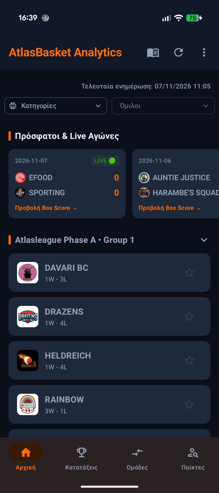
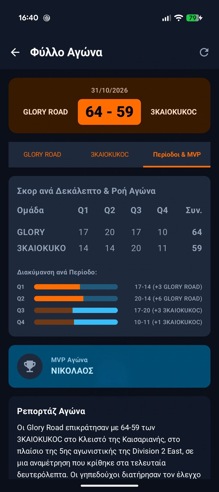
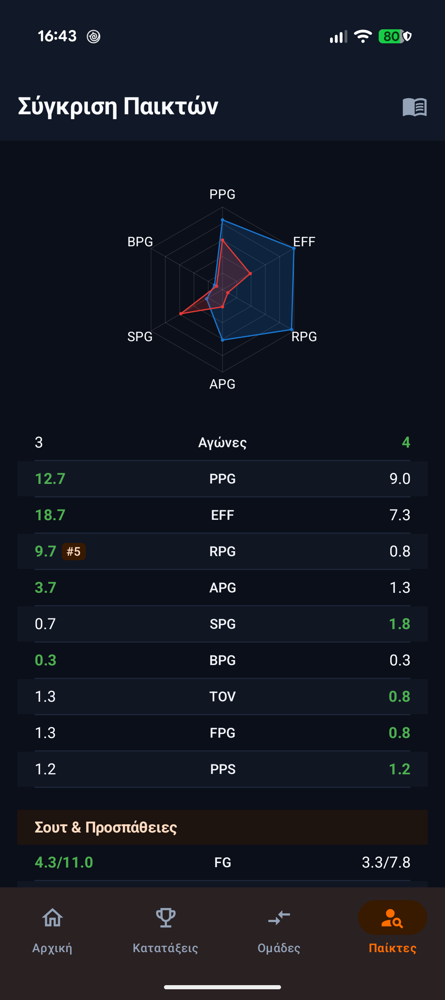
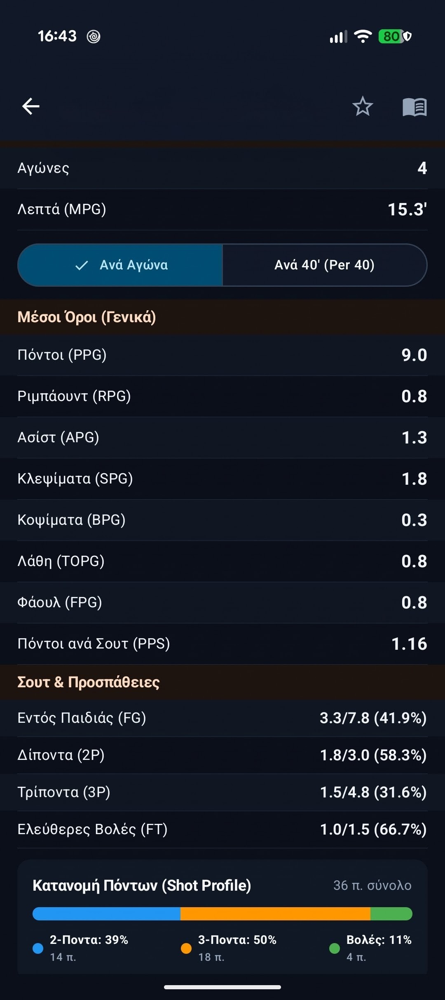

  

<h1 align="center">AtlasBasket Analytics (Android)</h1>

  <strong>Η κορυφαία εφαρμογή στατιστικής ανάλυσης & scouting για το ερασιτεχνικό πρωτάθλημα AtlasBasket.</strong>

  
  
  

---

## 📖 Σχετικά με την Εφαρμογή

Το **AtlasBasket Analytics** είναι μια σύγχρονη native εφαρμογή Android, σχεδιασμένη για παίκτες, προπονητές και φιλάθλους του πρωταθλήματος AtlasBasket.

Σκοπός της είναι να συγκεντρώνει και να αναλύει τα δεδομένα των αγώνων, προσφέροντας:
- **Πλήρη εικόνα του πρωταθλήματος:** Ζωντανά αποτελέσματα και βαθμολογίες ανά όμιλο και κατηγορία.
- **Εις βάθος στατιστική κάλυψη:** Αναλυτικά box scores ανά περίοδο, κατανομή πόντων (shot profiles) και προηγμένες μετρικές (TS%, eFG%, AST/TO).
- **Οπτικές συγκρίσεις & Scouting:** Άμεση σύγκριση παικτών ή ομάδων μέσω radar charts, καθώς και αυτόματες αναφορές τακτικής και απόδοσης.

---

## 📸 Στιγμιότυπα Εφαρμογής (Screenshots)

<table align="center">
  <tr>
    <td align="center" width="25%">
      <strong>Αρχική & Βαθμολογίες</strong>  
      
    </td>
    <td align="center" width="25%">
      <strong>Box Score & MVP</strong>  
      
    </td>
    <td align="center" width="25%">
      <strong>Radar Σύγκριση</strong>  
      
    </td>
    <td align="center" width="25%">
      <strong>Scouting & Αναφορές</strong>  
      
    </td>
  </tr>
</table>

---

## 🏀 Βασικές Δυνατότητες

- 📊 **Προηγμένα Στατιστικά (Advanced Metrics):** Υπολογισμός True Shooting % (TS%), Effective Field Goal % (eFG%), Assist-to-Turnover Ratio (AST/TO), Offensive Rebound % (ORB%) και Turnovers %.
- 🕸️ **Radar / Spider Charts:** Διαδραστική οπτική σύγκριση παικτών και ομάδων σε 6 βασικές διαστάσεις του παιχνιδιού.
- 🎯 **Shot Profile & Box Scores:** Πλήρη στατιστικά ανά δεκάλεπτο, ανάδειξη MVP (PIR) και κατανομή πόντων (2π, 3π, βολές).
- 🧠 **AI Scouting Engine:** Αυτόματες αναλύσεις τακτικής, εντοπισμός αδυναμιών και Δείκτης Σταθερότητας (CSI).
- ⚡ **Offline First:** Τοπική αποθήκευση δεδομένων (Room Database) για αστραπιαία πλοήγηση χωρίς κολλήματα.
- 🔒 **100% Σεβασμός στην Ιδιωτικότητα:** Πλήρης συμμόρφωση με GDPR (Άρθρο 7 παρ. 3), χωρίς διαφημίσεις και χωρίς καταγραφή προσωπικών δεδομένων.

---

## 📲 Οδηγός Εγκατάστασης (Android)

1. Κατεβάστε το [atlasbasket-v1.0.1-github.apk](https://github.com/boxlab-dev/atlasbasket_analytics/releases/latest/download/atlasbasket-v1.0.1-github.apk).
2. Όταν σας ζητηθεί, επιτρέψτε την *«Εγκατάσταση από άγνωστες πηγές»* στο πρόγραμμα περιήγησης (Chrome κλπ.).
3. Πατήστε **Εγκατάσταση (Install)**.
4. Ανοίξτε την εφαρμογή και πατήστε **Συγχρονισμός Διοργανώσεων** στην Αρχική Οθόνη.

> [!NOTE]
> Η εφαρμογή ελέγχει αυτόματα αν υπάρχει νεότερη έκδοση και ενημερώνει τον χρήστη απευθείας μέσα από το περιβάλλον της.

---

## 📬 Επικοινωνία & Υποστήριξη

- 🏢 **Ανάπτυξη:** [BoxLab](mailto:support@boxlab.gr)
- ✉️ **Email Υποστήριξης:** [support@boxlab.gr](mailto:support@boxlab.gr)
- 📦 **Όλες οι εκδόσεις:** [GitHub Releases](https://github.com/boxlab-dev/atlasbasket_analytics/releases)

---

  Το AtlasBasket και τα σχετικά λογότυπα αποτελούν εμπορικά σήματα των αντίστοιχων κατόχων τους. 
  Η εφαρμογή αποτελεί ανεξάρτητη προσπάθεια και δεν συνδέεται με τη διοργανώτρια αρχή του πρωταθλήματος.

